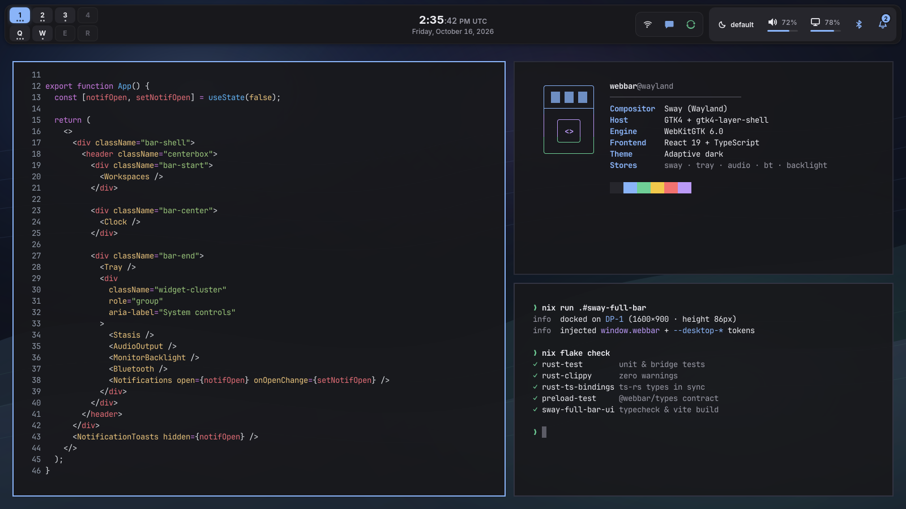
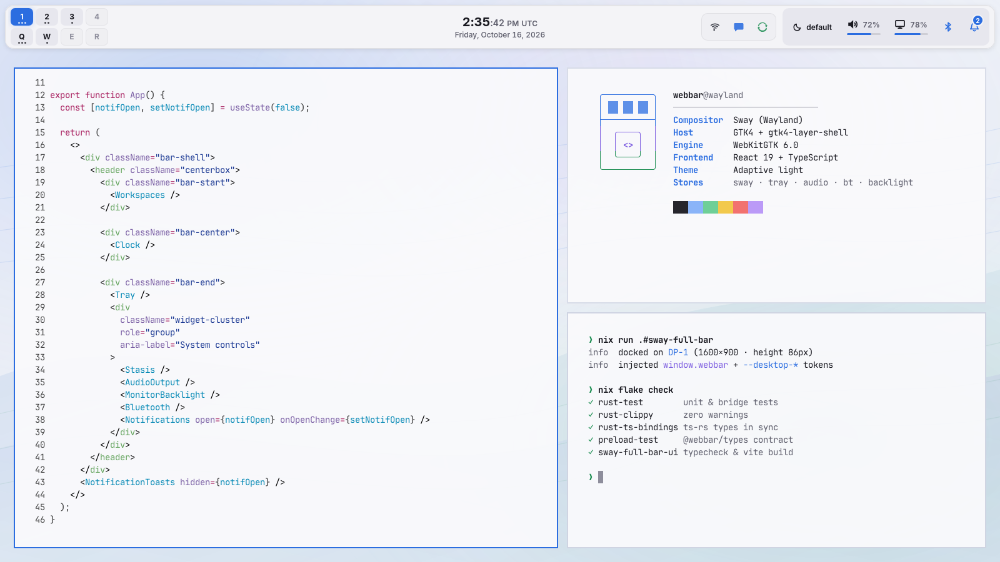
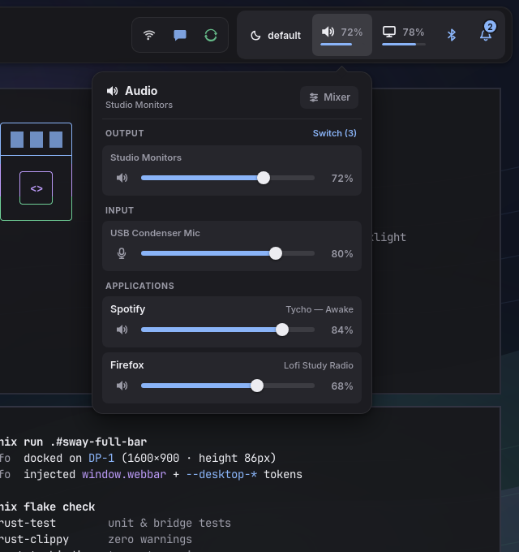
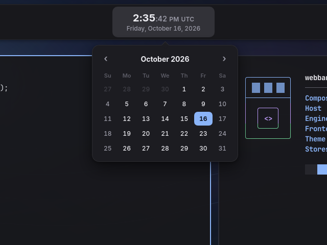
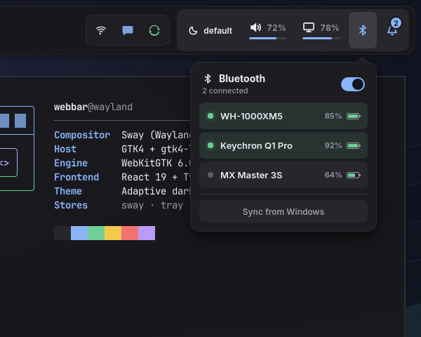
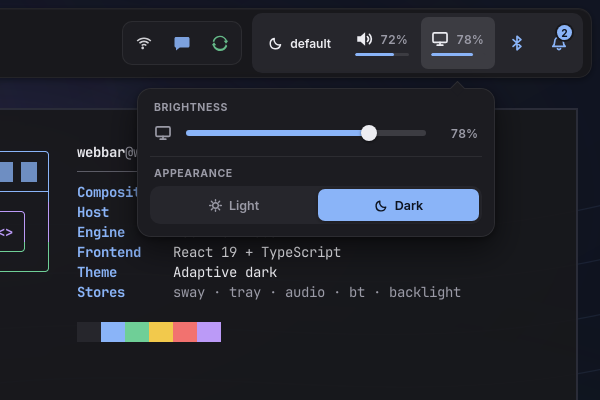
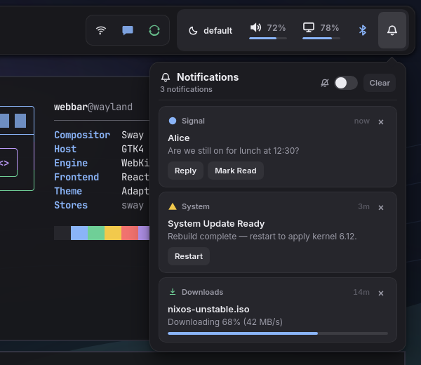
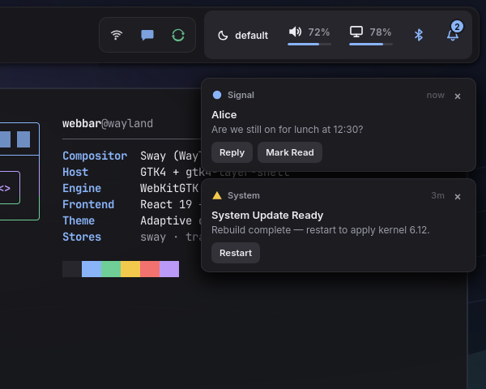

# webbar

Build your Sway status bar with plain HTML, CSS, and TypeScript/React—without switching away from Sway or reinventing Linux D-Bus plumbing.

`webbar` is a Rust Wayland host (`gtk4` + `gtk4-layer-shell` + `webkit6`) that docks a transparent WebView at the top of each monitor and automatically injects `window.webbar` into every page with reactive stores (`sway`, `tray`, `notifications`, `audio`, `bluetooth`, `network`, `backlight`, `theme`) plus Promise-based `dbus` and `exec` escape hatches. System appearance (dark/light mode, accent color, font, and GTK4/Libadwaita colors) is also injected as `--desktop-*` and `--gtk-*` CSS variables—see [THEMING.md](THEMING.md).

## Usage

Pass either a directory containing `index.html` or a dev server URL, and optionally `--height <px>` (default `34`):

```bash
webbar --dir /path/to/dist
webbar --url http://localhost:5173
webbar --dir ./examples/sway-full-bar/dist --height 86
```

## Example Bar Screenshots

`webbar` itself imposes no layout or styling—you build whatever bar you want with standard web technologies (HTML, CSS, and JavaScript/TypeScript). The screenshots below show [`examples/sway-full-bar`](examples/sway-full-bar), an included reference bar built for Sway that demonstrates workspaces, clock/calendar, notifications, system tray, idle controls, audio mixer, display brightness, Bluetooth, and automatic dark/light theming (see [THEMING.md](THEMING.md)).

### Dark Theme



### Adaptive Light Theme



### Interactive Popovers

| Audio Mixer | Clock & Calendar |
| :---: | :---: |
|  |  |
| **Bluetooth** | **Display & Appearance** |
|  |  |
| **Notification Center** | **Floating Toasts** |
|  |  |

<!-- Regenerate example screenshots in an isolated headless Sway session with: nix run .#update-screenshots -->

## Running with Nix

```bash
# Run with the minimal vanilla TS example
nix run . -- --dir ./examples/minimal/dist

# Run with the React tray example
nix run . -- --dir ./examples/react-tray/dist

# Run the React Sway full bar example (built by Nix)
nix run .#sway-full-bar

# Enter a dev shell with Rust, Node, GTK4, gtk4-layer-shell, and WebKitGTK 6.0
nix develop
```

## Running without Nix

Requires `rustc`/`cargo`, `node`/`npm`, and system dev libraries for `gtk4`, `gtk4-layer-shell-0`, `webkitgtk-6.0`, and `libpulse`.

```bash
# 1. Install workspace dependencies and build an example bar UI (e.g. examples/minimal or examples/react-tray)
npm install
npm --workspace=examples/minimal run build

# 2. Build and run webbar
cargo run -- --dir ./examples/minimal/dist
```

### Live Reload with Vite (`examples/sway-full-bar`)

Run both the Vite dev server and `webbar` with a single command from the repo root:

```bash
nix run .#sway-full-bar-dev
```

Or start them in two terminals manually (`--replace` swaps out any already-running `webbar` instance):

```bash
# Terminal 1: start Vite dev server (inside nix develop if you don't have Node locally)
cd examples/sway-full-bar
npm install
npm run dev

# Terminal 2: launch webbar against the Vite dev server
nix run . -- --url http://localhost:5173 --height 86 --replace
# Or with Cargo directly:
# cargo run -- --url http://localhost:5173 --height 86 --replace
```

Edits to `examples/sway-full-bar/src/` will hot-reload in the bar, and `webbar` automatically replays the latest system snapshots on reload.

#### External Browser Dev Mode (WebSocket Bridge)

To iterate on `examples/sway-full-bar` in a standard browser (or an automated browser agent such as [Antigravity's browser subagent](https://antigravity.google/docs/ide/browser/)) with live `window.webbar` data and without replacing your running desktop bar:

```bash
nix run .#sway-full-bar-browser-dev
```

This starts a headless `webbar --ws-bridge 9123` backend alongside Vite on `http://localhost:5173` and prints a tokenized URL such as `http://localhost:5173?wsPort=9123&wsToken=...` (overrides: `WEBBAR_WS_PORT`, `WEBBAR_VITE_PORT`, `WEBBAR_WS_TOKEN`). Or run them separately:

```bash
# Terminal 1: headless Rust backend bridge (prints a per-session ws://...?token=... URL)
nix run . -- --ws-bridge 9123

# Terminal 2: build @webbar/types once, then start Vite
npm --workspace=@webbar/types run build
npm --workspace=examples/sway-full-bar run dev -- --port 5173 --strictPort
```

## Sway Keybindings & DevTools

You can bind Sway keys directly to `webbar`'s notification and DevTools `gapplication` actions (these work even when the bar does not have keyboard focus):

```sway
bindsym $mod+n       exec gapplication action dev.local.webbar notifications-toggle-center
bindsym $mod+Shift+n exec gapplication action dev.local.webbar notifications-toggle-dnd
bindsym $mod+x       exec gapplication action dev.local.webbar notifications-dismiss-latest
bindsym $mod+Shift+x exec gapplication action dev.local.webbar notifications-clear-all
bindsym $mod+Shift+i exec gapplication action dev.local.webbar devtools
```

You can also open the WebKit Web Inspector (DOM, Console, Sources, Network, Storage) by passing `--devtools` on startup, or—when the bar has keyboard focus (e.g. while an overlay is open)—by pressing `F12` / `Ctrl+Shift+I` or right-clicking the bar and choosing **Inspect Element**.

> **Note:** Only one daemon can own `org.freedesktop.Notifications` or `org.kde.StatusNotifierWatcher` on your session D-Bus at a time. If another bar or notification daemon (`waybar`, `mako`, `swaync`) is already running, `webbar` logs a warning and still runs, but notifications/tray items stay with the existing daemon until it is stopped. Pass `--no-notifications` if you want `webbar` to leave `org.freedesktop.Notifications` unclaimed for another daemon.

## Testing & Checks

Run all Rust, preload, and frontend checks reproducibly with Nix:

```bash
nix flake check
```

Or run individual suites locally (or inside `nix develop`):

```bash
# Rust unit tests, lint, and ts-rs binding generation
cargo test
cargo clippy --all-targets

# Install workspace dependencies once at the repo root
npm install

# Preload bridge (@webbar/types) build, typecheck, and contract tests
npm --workspace=@webbar/types run build && npm --workspace=@webbar/types test

# Typecheck and build all workspaces (preload, examples/minimal, examples/sway-full-bar, examples/sway-full-bar-shared, examples/sway-full-bar-svelte, examples/react-tray)
npm run --workspaces typecheck
npm run --workspaces build
```

## Architecture & Credits

- See [DESIGN.md](DESIGN.md) for the three-layer architecture, store contracts, composable Wayland input regions, and daemon lifecycle, and [THEMING.md](THEMING.md) for `--desktop-*`/`--gtk-*` CSS tokens and themed icons.

- Rust payload types use `ts-rs` to generate `preload/src/generated/*.ts` (verified in sync by `nix flake check`).
- `preload/` is packaged as the `@webbar/types` workspace (`preload/src/preload.ts` and `preload/src/index.ts`), compiling `generated/preload.js` and `preload/dist/` while providing `{ get, subscribe, onChange }` stores compatible with React's `useSyncExternalStore` and vanilla TypeScript, `window.webbar.output` per monitor, and `AbortSignal` cancellation on `exec` and `dbus.watch`.
- System state (`sway`, `tray`, `notifications`, `audio`, `bluetooth`, `network`, `backlight`, `theme`) is aggregated once in the Rust host and shared across all monitor WebViews.
- [`src/dbus_json.rs`](src/dbus_json.rs) and [`src/tray.rs`](src/tray.rs) were originally inspired by [domicile](https://github.com/cprussin/domicile) (MIT License).
